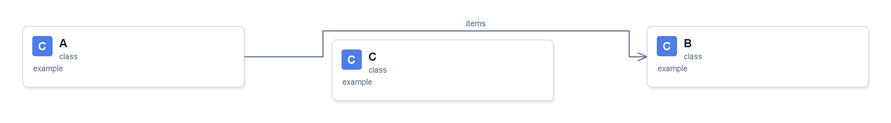

# Class Diagrams for OpenIDE

Плагин строит интерактивные UML-диаграммы по выбранным Java-классам, файлам
или папкам. Подготовлен для установленного **OpenIDE 2026.2.3, сборка 262.10968.63.1**.
**Версия 1.1.0**: автоматический обход карточек стрелками и ручная правка маршрутов.
Готовые ZIP-пакеты публикуются в [GitHub Releases](https://github.com/artemalo/plugin-openide-class-diagrams/releases).
После локальной сборки пакет находится в `dist/class-diagrams-1.1.0.zip`.



## Установка

1. В OpenIDE откройте **Settings → Plugins** (`Ctrl+Alt+S`, затем раздел Plugins).
2. Нажмите шестерёнку и выберите **Install Plugin from Disk…** / **Установить плагин с диска**.
3. Выберите **ZIP целиком**, распаковывать его не нужно:
   `class-diagrams-1.1.0.zip`.
4. Примените изменения и перезапустите IDE, если она это предложит.

В установленном списке плагин называется **Class Diagrams for OpenIDE**.
Установка 1.1.0 обновит прежнюю версию с тем же ID. Для возврата можно установить
сохранённый ZIP 1.0.0 через тот же пункт меню; если IDE не предложит понижение версии,
удалите плагин через Settings → Plugins, перезапустите IDE и установите старый ZIP.

## Создание диаграммы

В окне **Project** выделите нужные `.java`-файлы с Ctrl либо выберите папку с ними.
Нажмите правую кнопку и выберите **Построить UML-диаграмму классов**.
Откроется панель **Class Diagrams** с новой вкладкой.

Тот же пункт есть в **Tools** и в контекстном меню Java-редактора.
Из редактора строится диаграмма класса под курсором; если курсор вне класса — всего файла.
Если IDE индексирует проект, дождитесь завершения индексации и повторите команду.

Для лабораторной выделите `Fraction.java` и `Main.java`; при необходимости
также добавьте `FractionTest.java`. Переключатель **Связанные классы** добавит
непосредственных соседей, например `Comparable`, даже если их не выделяли.

## Управление

| Действие | Как выполнить |
| --- | --- |
| Переместить класс | Перетащить карточку левой кнопкой |
| Переместить диаграмму | Перетащить свободный фон или использовать среднюю кнопку |
| Изменить масштаб | Колесо мыши или кнопки − и + |
| Показать всё | Вписать |
| Перестроить расположение | Раскладка; возвращает и скрытые карточки |
| Перейти к классу или члену | Двойной щелчок по заголовку, полю или методу |
| Скрыть класс с диаграммы | Delete либо контекстное меню карточки; исходник сохраняется |
| Найти класс | Ввести имя в поле поиска — совпадения выделяются |
| Перечитать изменённый код | Обновить |
| Изменить маршрут стрелки | Потянуть линию мышью; появится квадратная точка изгиба |
| Добавить точку | Двойной щелчок по линии или контекстное меню стрелки |
| Переместить точку | Выделить стрелку и потянуть квадратный маркер |
| Изменить крепление стрелки | Потянуть круглый маркер к другой стороне того же класса |
| Удалить точку | Выделить квадратный маркер и нажать Delete |
| Вернуть одну стрелку в автоматический режим | Выделить стрелку и нажать R или выбрать «Автоматический маршрут» в её меню |
| Сбросить все стрелки | Автострелки; позиции классов сохраняются |
| Подготовить диаграмму для отчёта | Выбрать нужные поля/методы и Экспорт → SVG или PNG |

Можно скрыть поля, методы, непубличные члены и обычные зависимости.
Цвета различают классы, интерфейсы, enum и record. Статические члены
подчёркнуты, абстрактные выделены курсивом. В узкой панели кнопки переносятся
на следующую строку. Панель можно расширить или сделать плавающей средствами IDE.

## Стрелки в версии 1.1.0

Автоматический маршрут состоит из горизонтальных и вертикальных отрезков.
Стрелка выбирает подходящие стороны классов, учитывает размер карточек и обходит
остальные карточки. При перемещении класса маршруты пересчитываются.

При ручной правке квадратные точки фиксируются в координатах диаграммы.
Концы стрелки остаются прикреплены к своим классам и следуют за ними; участки
между ручными точками продолжают обходить карточки автоматически.
Переключение фильтров и «Обновить» сохраняют ручные маршруты неизменившихся связей.
«Раскладка» сбрасывает и позиции классов, и ручные маршруты.

Если карточки перекрываются или ручная точка находится внутри карточки, безопасный
обход может быть невозможен. Такая стрелка становится оранжевой: переместите точку,
раздвиньте классы или верните автоматический маршрут. Пересечения стрелок друг
с другом не запрещены. Правка маршрута не меняет исходники или смысл связи UML.

## Связи UML

- Сплошная линия с пустым треугольником — наследование.
- Пунктир с пустым треугольником — реализация интерфейса.
- Сплошная стрелка с именем поля — ассоциация.
- Пунктирная стрелка — зависимость, включая использование в теле метода.
- `+` — public, `-` — private, `#` — protected, `~` — доступ в пакете.

Типы параметров коллекций и массивов учитываются: поле `List<Order>` создаёт
связь с `Order`. Для массива дополнительно ставится `[*]`. Композиция и агрегация
не угадываются по наличию поля: жизненный цикл объекта нельзя надёжно вывести
только из объявления типа. Если уже есть более сильная связь между двумя классами,
лишняя стрелка зависимости не рисуется.

## Экспорт

- **SVG** — векторный файл для отчёта, масштабируется без потери качества.
- **PNG** — изображение с белым фоном; очень большие диаграммы автоматически уменьшаются.
- **PlantUML** — текстовое описание `.puml`, пригодное для дальнейшего редактирования.

Экспорт отражает текущие фильтры и, для SVG/PNG, ручное расположение карточек
и маршруты стрелок. Маркеры редактирования в экспорт не входят. PlantUML хранит
структуру связей; расположение рассчитывается его собственным рендерером.
Длинные сигнатуры в карточках сокращаются многоточием; полная запись доступна
во всплывающей подсказке и в PlantUML. Никакие исходники не отправляются в сеть.
Graphviz и дополнительные библиотеки для установленного плагина не нужны.

## Границы версии 1.1

Поддерживается Java; Kotlin в этой версии не анализируется. Это самостоятельный
просмотрщик UML, а не копия всех возможностей Diagrams из IntelliJ IDEA.
Редактирование Java-кода через диаграмму и сохранение расположения между
перезапусками не реализованы; это относится и к ручным точкам стрелок.
После правки исходников нужно нажать **Обновить**.

За один раз анализируются до 120 выбранных классов и до 2000 файлов;
с непосредственными соседями на диаграмме может быть до 240 классов.
При достижении ограничения появляется сообщение. Анонимные классы и параметры
типов не становятся отдельными карточками. Папки сборки и исключённые каталоги
пропускаются. Внешние библиотечные зависимости не добавляются, кроме базовых
классов и интерфейсов; `Object` не показывается. Недописанный или неразрешимый
код может дать неполный набор связей — исправьте ошибки проекта и обновите диаграмму.

## Сборка и проверки

Используется SDK установленного OpenIDE; загрузка Gradle или другого экземпляра
IDE не требуется. В PowerShell из этой папки:

```powershell
.\build.ps1
.\test.ps1
.\integration-test.ps1
```

Если IDE находится в другом месте, передайте `-IdeHome 'путь к OpenIDE'`.
Для другой ветки платформы потребуется проверить совместимость и изменить
`idea-version` в `src/main/resources/META-INF/plugin.xml`.

`test.ps1` проверяет фильтры, размещение, обработку циклов, экспорт, экранирование
типов Java, масштабирование, отрисовку, обход препятствий и жесты мыши для стрелок.
`test-core.ps1 -JdkHome 'путь к JDK'` запускает проверки ядра без OpenIDE;
он же используется в GitHub Actions. `integration-test.ps1` запускает реальный
OpenIDE без графического окна, в изолированном профиле `sandbox`, проверяет загрузку
плагина, регистрацию действия и извлечение графа через Java PSI. Проверочный плагин
из `src/integration` не входит в установочный ZIP. Результаты — в `build/verification`
и `build/integration`.

Тестовый запуск не устанавливает плагин в обычный пользовательский профиль.

Подготовка архивов и порядок публикации описаны в [RELEASING.md](RELEASING.md).
Список изменений: [CHANGELOG.md](CHANGELOG.md). Сборка берёт номер версии из
`plugin.xml`, поэтому пакет 1.1.0 не перезаписывает архив 1.0.0.

## Документация платформы

- [Диаграммы IntelliJ IDEA](https://www.jetbrains.com/help/idea/class-diagram.html).
- [Действия плагина](https://plugins.jetbrains.com/docs/intellij/creating-actions-tutorial.html).
- [Панели инструментов](https://plugins.jetbrains.com/docs/intellij/tool-windows.html).
- [Модель потоков и фоновые read actions](https://plugins.jetbrains.com/docs/intellij/threading-model.html).
